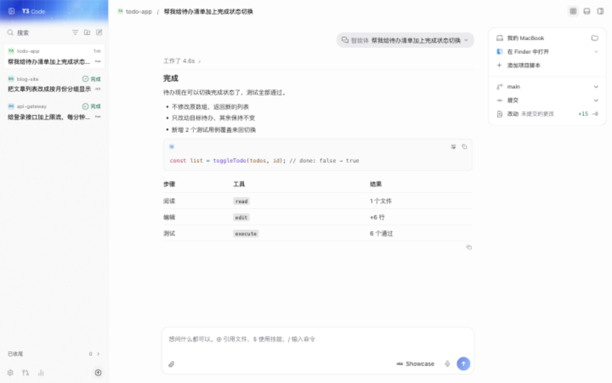
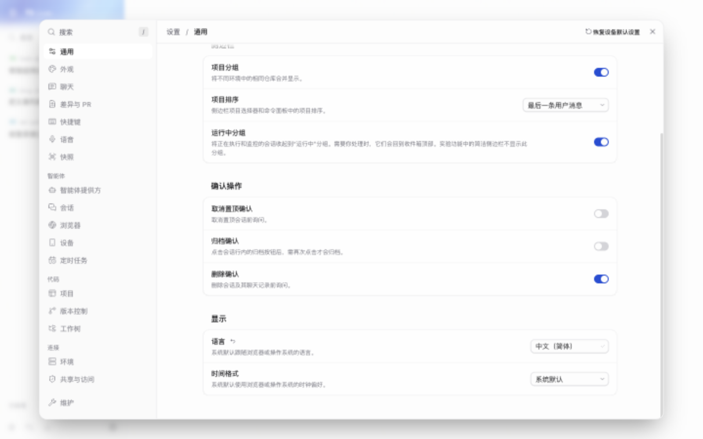
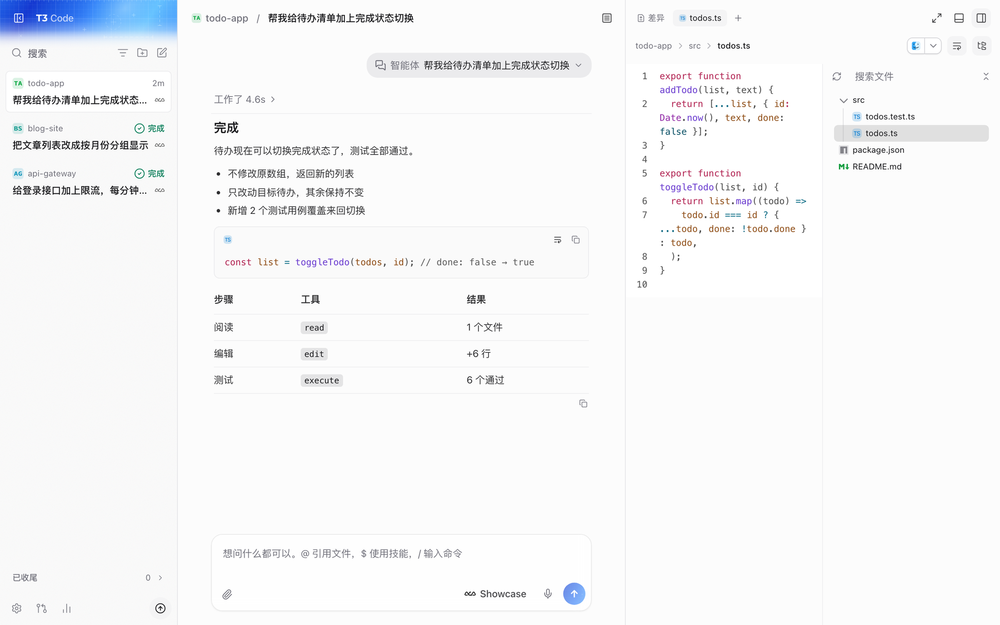

<div align="center">

<a href="https://github.com/deepfry666/t3code-cn/releases/latest">
  
</a>

# T3 Code 中文版

**用中文操控你电脑上的编程智能体。**

Claude Code、Codex、Cursor、OpenCode、Antigravity、Kiro 等主流智能体及 ACP 智能体都可以在一个窗口里管理：<br>
桌面、浏览器和手机都能用，用的是你自己的订阅。

[](https://github.com/deepfry666/t3code-cn/releases/latest)
[](https://github.com/deepfry666/t3code-cn/releases)
[](https://github.com/pingdotgg/t3code)
[](LICENSE)

[**换到官方版**](#如何换到官方版) · [下载官方版](https://t3.codes/download) · [和官方中文有什么不同](#和官方中文有什么不同) · [常见问题](#常见问题)

</div>

> [!IMPORTANT]
> **本项目已停止维护，最后一个版本是 0.1.10-cn.4。**
> 官方 T3 Code 从 0.1.11 起自带完整的中文界面（桌面、网页和手机都有），请换用 [官方版](https://t3.codes/download)。换过去以后，会话、项目和设置都会保留，步骤见 [如何换到官方版](#如何换到官方版)。

<br>



## 如何换到官方版

官方发布 0.1.11 或更新的版本后：

1. 完全退出 T3 Code 中文版。建议先把数据目录 `~/.t3/userdata` 复制一份备份（Windows 上是 `%USERPROFILE%\.t3\userdata`）。
2. 从 [t3.codes/download](https://t3.codes/download) 下载官方版，或者用包管理器安装：macOS `brew install --cask t3-code`，Windows `winget install T3Tools.T3Code`。
3. 直接覆盖安装，不需要先卸载，也不要删除 `~/.t3`。macOS 上把官方版拖进“应用程序”文件夹，替换现有的 **T3 Code (Beta)**。
4. 打开后到 **设置 → 通用 → 显示 → 语言**，确认选的是“中文（简体）”。

需要注意：

- **数据为什么还在**：中文版一直沿用官方的应用标识和 `~/.t3` 数据目录，官方版读的是同一份数据。
- **只需手动装一次**：中文版和官方版的签名不同，中文版不会自动更新成官方版。装上官方版以后，更新由官方负责。
- **不要再装回中文版**：0.1.11 比 0.1.10-cn.4 新，数据库会自动升级，旧版本不一定能读升级后的数据。
- **命令行 `t3`**：运行官方安装命令 `curl -fsSL https://t3.codes/install.sh | sh` 即可覆盖（Windows PowerShell：`irm https://t3.codes/install.ps1 | iex`）。
- **翻译问题**：官方中文里如果有翻得不好的地方，请到 [官方仓库](https://github.com/pingdotgg/t3code) 或 [中文翻译讨论](https://github.com/pingdotgg/t3code/discussions/34709) 反馈。

## 为什么做这个版本

[T3 Code](https://github.com/pingdotgg/t3code) 是一个开源的智能体控制台：在一个界面里同时跑多个会话，看智能体读了哪些文件、改了哪些代码，支持工作树隔离、引用回复、自定义主题与工作时保持唤醒，随时批准、回退、开 PR。它很好用，但是英文界面。

中文版只做一件事：**把界面完整地翻成好懂的中文**。功能和官方完全一致，维护期间一直跟着官方版本更新。

- **翻得全**：10,500 多条界面文字，覆盖设置、侧边栏、会话、命令面板、主题外观、Git 与 PR、文件预览、浏览器、设备、定时任务、语音与用量，以及桌面应用的原生菜单。
- **译得一致**：同一个英文词在任何地方都是同一个中文词。thread 一律是“会话”，agent 一律是“智能体”，由自动检查保证，不会这里一个说法、那里又是另一个说法。
- **读得顺**：按中文习惯重写句子，不逐字硬翻；Finder、PR 这类大家习惯说英文的词保留英文。

## 和官方中文有什么不同

2026 年 11 月 12 日，官方合并了界面语言切换功能（[#31313](https://github.com/pingdotgg/t3code/pull/31313)），附带的中文翻译只覆盖设置页的 70 多条文字，术语也和中文版不同。11 月 18 日，官方在 [#37893](https://github.com/pingdotgg/t3code/pull/37893) 把整个应用翻成了中文，约一万条文字，用词也改成了和中文版一致的“会话”“智能体”等。下表是 11 月 12 日那版的差异，留作记录：

| 英文原文                                              | 官方中文                                       | 中文版                                 |
| ----------------------------------------------------- | ---------------------------------------------- | -------------------------------------- |
| Threads                                               | 线程                                           | 会话                                   |
| Agents                                                | 代理                                           | 智能体                                 |
| Working section                                       | Working 分区                                   | 运行中分组                             |
| Labs                                                  | Labs                                           | 实验功能                               |
| Scheduled tasks                                       | 计划任务                                       | 定时任务                               |
| Confirm thread deletion                               | 删除线程前确认                                 | 确认删除会话                           |
| “…The boring sidebar in Labs has no Working section.” | “Labs 中的 boring sidebar 没有 Working 分区。” | “实验功能中的简洁侧边栏不显示此分组。” |

官方中文现在已经足够完整，中文版也就完成了它的任务，这是停止维护的原因。

<details>
<summary>为什么“会话”比“线程”好？</summary>

<br>

在 T3 Code 里，thread 指的是你和智能体的一次完整对话及其工作记录，和编程里的“线程”（并发执行单元）不是一回事。写代码的人看到“线程”会先想到并发，反而容易误会。所以中文版统一用“会话”。完整术语表见 [`i18n/README.md`](i18n/README.md)。

</details>

<table>
<tr>
<td width="50%"></td>
<td width="50%"></td>
</tr>
<tr>
<td align="center">设置页：分类、说明文字全部是中文</td>
<td align="center">工作区：边看对话边看文件和改动</td>
</tr>
</table>

## 三步上手

<details>
<summary><b>旧版中文版的安装说明（0.1.10-cn.4，已不再更新，推荐使用官方版）</b></summary>

**1. 下载安装**

到 [最新版本](https://github.com/deepfry666/t3code-cn/releases/latest) 下载对应系统的安装包：

| 系统                 | 下载这个文件                                           | 备注                                                                                                |
| -------------------- | ------------------------------------------------------ | --------------------------------------------------------------------------------------------------- |
| Windows（x64）       | `T3-Code-<版本>-x64.exe`                               | 出现 SmartScreen 提示时，点“更多信息”→“仍要运行”                                                    |
| macOS（Apple 芯片）  | `T3-Code-<版本>-arm64.dmg`                             | 首次打开需要手动放行一次，见[下方说明](#macos-首次打开)                                             |
| Linux（x64 / arm64） | `T3-Code-x86_64.AppImage` / `arm64.AppImage` 或 `.deb` | AppImage 支持应用内自动更新（文件名不含版本号）；`.deb` 为 `T3-Code-<版本>-amd64.deb` / `arm64.deb` |
| Linux / macOS 命令行 | `t3-<版本>-<系统>.tar.gz`                              | 也可以用下面的一行命令安装                                                                          |

只想要命令行版（`t3`）的话，在 macOS（Apple 芯片）或 Linux 上运行：

```bash
curl -fsSL https://raw.githubusercontent.com/deepfry666/t3code-cn/main/scripts/install.sh | sh
```

**2. 登录一个智能体**

T3 Code 本身不带模型，它调用你电脑上已经装好的智能体。至少装好并登录一个：

| 智能体   | 安装                                                  | 登录命令              |
| -------- | ----------------------------------------------------- | --------------------- |
| Claude   | [Claude Code](https://claude.com/product/claude-code) | `claude auth login`   |
| Codex    | [Codex CLI](https://developers.openai.com/codex/cli)  | `codex login`         |
| Cursor   | [Cursor CLI](https://cursor.com/cli)                  | `agent login`         |
| OpenCode | [OpenCode](https://opencode.ai)                       | `opencode auth login` |

也支持 Antigravity、Kiro、Grok Build、Pi、Muse Code、fx 及任何 [ACP](docs/user/providers-acp.md) 智能体，详细配置见官方的 [安装与首次运行](docs/user/install.md#providers)。

**3. 切到中文**

系统语言是中文时，首次打开会自动显示中文。如果还是英文，打开 **Settings → General → Display → Language**，选 **中文（简体）**，立即生效，不用重启。

</details>

## 常见问题

<details>
<summary><b>能和官方英文版同时安装吗？</b></summary>

<br>

不能。中文版沿用官方的应用标识和 `~/.t3` 数据目录，这样登录、T3 Connect、远程连接都和官方一样工作，也能直接读到你以前的对话记录。代价是两者只能装一个：安装前请先卸载官方桌面版，并备份 `~/.t3`。也不要在两个版本之间来回切换，版本不一致时数据库可能无法回退。

</details>

<details>
<summary><b>智能体会用中文回答吗？</b></summary>

<br>

界面语言只影响按钮、菜单和提示文字，不影响模型。想让智能体用中文回答，直接用中文提问，或者在项目的 `AGENTS.md`、`CLAUDE.md` 里写上“请用中文回答”。项目名、文件路径、代码、终端输出和第三方错误信息保持原样，不会被翻译。

</details>

<a id="macos-首次打开"></a>

<details>
<summary><b>macOS 提示“无法验证开发者”怎么办？</b></summary>

<br>

中文版使用自己的签名证书，没有经过 Apple 公证，所以第一次打开会被拦下。放行一次即可，之后的自动更新不需要再放行：

1. 先把 **T3 Code (Beta)** 从 dmg 拖进“应用程序”文件夹（在 dmg 里直接运行的应用无法自动更新）。
2. 双击打开一次，关掉提示，然后到 **系统设置 → 隐私与安全性**，在页面下方点 **仍要打开**。
3. 或者在终端执行：`xattr -dr com.apple.quarantine "/Applications/T3 Code (Beta).app"`

从官方版换过来后，屏幕录制、麦克风等系统权限需要重新授予一次。

</details>

<details>
<summary><b>官方的安装命令、npx t3@latest、winget、Homebrew 能装中文版吗？</b></summary>

<br>

不能，它们（以及 AUR、Nix 等官方分发渠道）安装的是官方英文版。中文版请从本仓库的 [Releases](https://github.com/deepfry666/t3code-cn/releases) 下载，或使用上面的命令行安装脚本。

</details>

<details>
<summary><b>还有哪些没有汉化？有什么限制？</b></summary>

<br>

- iOS / Android 手机客户端的中文由官方维护，本仓库不单独汉化。
- 少数系统弹窗（启动恢复、浏览器权限、通行密钥）仍是英文。
- 没有官方签名，macOS 上的通行密钥（Passkey）登录可能不可用，可以改用其他登录方式。
- 目前还没有 Intel Mac 安装包和 Windows 命令行程序，正在陆续补上。

完整说明见 [中文使用说明](docs/user/chinese.md)。

</details>

<details>
<summary><b>怎么切回英文？</b></summary>

<br>

**设置 → 通用 → 显示 → 语言** 选 **English**，立即生效。

</details>

## 参与改进

本仓库已停止维护，不再处理新的问题。

- **翻译问题**：请到 [官方仓库](https://github.com/pingdotgg/t3code/issues) 或 [中文翻译讨论](https://github.com/pingdotgg/t3code/discussions/34709) 反馈。
- **想参考中文版的译法**：全部译文都在 [`i18n/zh-CN.json`](i18n/zh-CN.json) 里，按文件列出“英文原文 → 中文”，术语约定见 [`i18n/README.md`](i18n/README.md)。
- **功能问题**：请到 [官方仓库](https://github.com/pingdotgg/t3code/issues) 反馈。

觉得好用的话，点个 Star 让更多人看到。

<details>
<summary><b>从源码构建</b></summary>

<br>

先安装 [Vite+](https://viteplus.dev/guide/) 提供的 `vp` 命令（macOS / Linux：`curl -fsSL https://vite.plus | bash`；Windows PowerShell：`irm https://vite.plus/ps1 | iex`），然后：

```bash
git clone https://github.com/deepfry666/t3code-cn.git
cd t3code-cn
vp i
vp run dev                # 本地运行服务端和 Web 界面
vp run dist:desktop:dmg   # 打包 macOS 桌面应用（未签名）
```

架构说明见 [docs/internals/overview.md](docs/internals/overview.md)。

</details>

## 许可证

这是 T3 Code 的非官方分支，不代表原团队，也不由原团队提供支持。沿用原项目的 [MIT 许可证](LICENSE)，保留原作者版权声明。感谢 [T3 Code 团队](https://github.com/pingdotgg/t3code) 把它开源。
