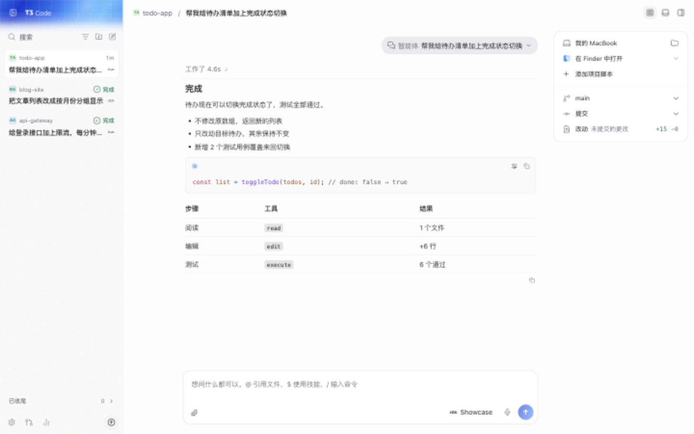
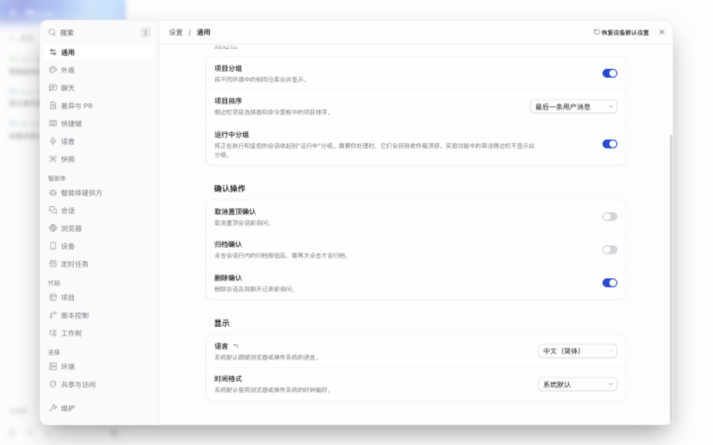
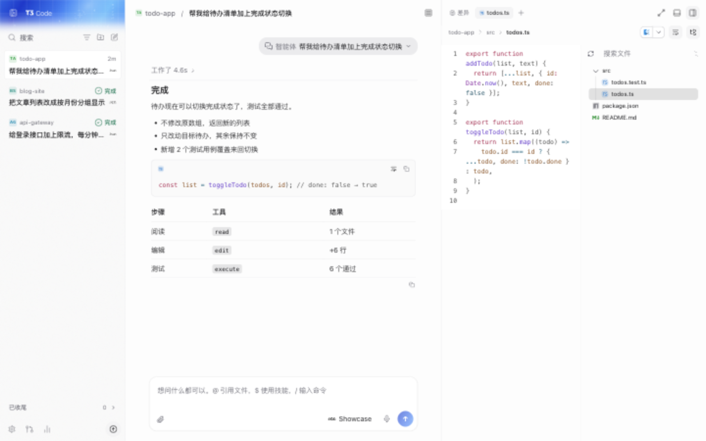

<div align="center">

# T3 Code 中文版

**用中文操控你电脑上的编程智能体。**

Claude Code、Codex、Cursor、OpenCode 等智能体都可以在一个窗口里管理：<br>
桌面、浏览器和手机都能用，用的是你自己的订阅。

[](https://github.com/deepfry666/t3code-cn/releases/latest)
[](https://github.com/deepfry666/t3code-cn/releases)
[](https://github.com/pingdotgg/t3code)
[](LICENSE)

[**下载最新版**](https://github.com/deepfry666/t3code-cn/releases/latest) · [三步上手](#三步上手) · [和官方中文有什么不同](#和官方中文有什么不同) · [常见问题](#常见问题)

</div>

<br>



## 为什么做这个版本

[T3 Code](https://github.com/pingdotgg/t3code) 是一个开源的智能体控制台：在一个界面里同时跑多个会话，看智能体读了哪些文件、改了哪些代码，随时批准、回退、开 PR。它很好用，但是英文界面。

中文版只做一件事：**把界面完整地翻成好懂的中文**。功能和官方完全一致，官方每发一个新版，这里通常一两天内跟进。

- **翻得全**：一万多条界面文字，覆盖设置、侧边栏、会话、命令面板、Git 与 PR、文件预览、浏览器、设备、用量，以及桌面应用的原生菜单。
- **译得一致**：同一个英文词在任何地方都是同一个中文词。thread 一律是“会话”，agent 一律是“智能体”，由自动检查保证，不会这里一个说法、那里又是另一个说法。
- **读得顺**：按中文习惯重写句子，不逐字硬翻；Finder、PR 这类大家习惯说英文的词保留英文。
- **更新省心**：安装一次，之后在应用内自动更新，不会被官方英文版覆盖。

## 和官方中文有什么不同

2026 年 11 月，官方合并了界面语言切换功能（[#31313](https://github.com/pingdotgg/t3code/pull/31313)），附带一份中文翻译。我们很高兴官方开始支持中文，但目前那份翻译只覆盖设置页的 70 多条文字，其余界面仍是英文，术语也和我们的不同：

| 英文原文                                              | 官方中文                                       | 中文版                                 |
| ----------------------------------------------------- | ---------------------------------------------- | -------------------------------------- |
| Threads                                               | 线程                                           | 会话                                   |
| Agents                                                | 代理                                           | 智能体                                 |
| Working section                                       | Working 分区                                   | 运行中分组                             |
| Labs                                                  | Labs                                           | 实验功能                               |
| Scheduled tasks                                       | 计划任务                                       | 定时任务                               |
| Confirm thread deletion                               | 删除线程前确认                                 | 确认删除会话                           |
| “…The boring sidebar in Labs has no Working section.” | “Labs 中的 boring sidebar 没有 Working 分区。” | “实验功能中的简洁侧边栏不显示此分组。” |

我们的做法是：**代码跟官方走，措辞用中文版的**。官方新增的翻译机制照常保留，官方已经翻过的文字会自动换成中文版的译法；官方没翻到的地方，继续由中文版补上。界面里始终只有一个语言开关，选“中文（简体）”看到的就是一套统一的说法。

<details>
<summary>为什么“会话”比“线程”好？</summary>

<br>

在 T3 Code 里，thread 指的是你和智能体的一次完整对话及其工作记录，和编程里的“线程”（并发执行单元）不是一回事。写代码的人看到“线程”会先想到并发，反而容易误会。所以中文版统一用“会话”。完整术语表见 [`i18n/README.md`](i18n/README.md)。

</details>

<table>
<tr>
<td width="50%"></td>
<td width="50%"></td>
</tr>
<tr>
<td align="center">设置页：分类、说明文字全部是中文</td>
<td align="center">工作区：边看对话边看文件和改动</td>
</tr>
</table>

## 三步上手

**1. 下载安装**

到 [最新版本](https://github.com/deepfry666/t3code-cn/releases/latest) 下载对应系统的安装包：

| 系统                 | 下载这个文件               | 备注                                                    |
| -------------------- | -------------------------- | ------------------------------------------------------- |
| Windows（x64）       | `T3-Code-<版本>-x64.exe`   | 出现 SmartScreen 提示时，点“更多信息”→“仍要运行”        |
| macOS（Apple 芯片）  | `T3-Code-<版本>-arm64.dmg` | 首次打开需要手动放行一次，见[下方说明](#macos-首次打开) |
| Linux / macOS 命令行 | `t3-<版本>-<系统>.tar.gz`  | 也可以用下面的一行命令安装                              |

只想要命令行版（`t3`）的话，在 macOS（Apple 芯片）或 Linux 上运行：

```bash
curl -fsSL https://raw.githubusercontent.com/deepfry666/t3code-cn/main/scripts/install.sh | sh
```

**2. 登录一个智能体**

T3 Code 本身不带模型，它调用你电脑上已经装好的智能体。至少装好并登录一个：

| 智能体   | 安装                                                  | 登录命令              |
| -------- | ----------------------------------------------------- | --------------------- |
| Claude   | [Claude Code](https://claude.com/product/claude-code) | `claude auth login`   |
| Codex    | [Codex CLI](https://developers.openai.com/codex/cli)  | `codex login`         |
| Cursor   | [Cursor CLI](https://cursor.com/cli)                  | `agent login`         |
| OpenCode | [OpenCode](https://opencode.ai)                       | `opencode auth login` |

更多智能体见官方的 [安装与首次运行](docs/user/install.md)。

**3. 切到中文**

系统语言是中文时，首次打开会自动显示中文。如果还是英文，打开 **Settings → General → Display → Language**，选 **中文（简体）**，立即生效，不用重启。

## 常见问题

<details>
<summary><b>能和官方英文版同时安装吗？</b></summary>

<br>

不能。中文版沿用官方的应用标识和 `~/.t3` 数据目录，这样登录、T3 Connect、远程连接都和官方一样工作，也能直接读到你以前的对话记录。代价是两者只能装一个：安装前请先卸载官方桌面版，并备份 `~/.t3`。也不要在两个版本之间来回切换，版本不一致时数据库可能无法回退。

</details>

<details>
<summary><b>智能体会用中文回答吗？</b></summary>

<br>

界面语言只影响按钮、菜单和提示文字，不影响模型。想让智能体用中文回答，直接用中文提问，或者在项目的 `AGENTS.md`、`CLAUDE.md` 里写上“请用中文回答”。项目名、文件路径、代码、终端输出和第三方错误信息保持原样，不会被翻译。

</details>

<a id="macos-首次打开"></a>

<details>
<summary><b>macOS 提示“无法验证开发者”怎么办？</b></summary>

<br>

中文版使用自己的签名证书，没有经过 Apple 公证，所以第一次打开会被拦下。放行一次即可，之后的自动更新不需要再放行：

1. 先把 **T3 Code (Beta)** 从 dmg 拖进“应用程序”文件夹（在 dmg 里直接运行的应用无法自动更新）。
2. 双击打开一次，关掉提示，然后到 **系统设置 → 隐私与安全性**，在页面下方点 **仍要打开**。
3. 或者在终端执行：`xattr -dr com.apple.quarantine "/Applications/T3 Code (Beta).app"`

从官方版换过来后，屏幕录制、麦克风等系统权限需要重新授予一次。

</details>

<details>
<summary><b>官方的安装命令、winget、Homebrew 能装中文版吗？</b></summary>

<br>

不能，它们安装的是官方英文版。中文版请从本仓库的 [Releases](https://github.com/deepfry666/t3code-cn/releases) 下载，或使用上面的命令行安装脚本。

</details>

<details>
<summary><b>还有哪些没有汉化？有什么限制？</b></summary>

<br>

- iOS / Android 手机客户端的中文由官方维护，本仓库不单独汉化。
- 少数系统弹窗（启动恢复、浏览器权限、通行密钥）仍是英文。
- 没有官方签名，macOS 上的通行密钥（Passkey）登录可能不可用，可以改用其他登录方式。
- 目前还没有 Linux 桌面安装包、Intel Mac 安装包和 Windows 命令行程序，正在陆续补上。

完整说明见 [中文使用说明](docs/user/chinese.md)。

</details>

<details>
<summary><b>怎么切回英文？</b></summary>

<br>

**设置 → 通用 → 显示 → 语言** 选 **English**，立即生效。

</details>

## 参与改进

- **发现翻得不对、漏翻的地方**：到 [Issues](https://github.com/deepfry666/t3code-cn/issues) 提交，附上截图和所在页面就行。
- **想自己改译文**：全部译文都在 [`i18n/zh-CN.json`](i18n/zh-CN.json) 里，按文件列出“英文原文 → 中文”，术语约定见 [`i18n/README.md`](i18n/README.md)。
- **与汉化无关的功能问题**：请先确认官方版本是否也有，再到 [官方仓库](https://github.com/pingdotgg/t3code/issues) 反馈。

觉得好用的话，点个 Star 让更多人看到。

<details>
<summary><b>从源码构建</b></summary>

<br>

先安装 [Vite+](https://viteplus.dev/guide/) 提供的 `vp` 命令（macOS / Linux：`curl -fsSL https://vite.plus | bash`；Windows PowerShell：`irm https://vite.plus/ps1 | iex`），然后：

```bash
git clone https://github.com/deepfry666/t3code-cn.git
cd t3code-cn
vp i
vp run dev                # 本地运行服务端和 Web 界面
vp run dist:desktop:dmg   # 打包 macOS 桌面应用（未签名）
```

架构说明见 [docs/internals/overview.md](docs/internals/overview.md)。

</details>

## 许可证

这是 T3 Code 的非官方分支，不代表原团队，也不由原团队提供支持。沿用原项目的 [MIT 许可证](LICENSE)，保留原作者版权声明。感谢 [T3 Code 团队](https://github.com/pingdotgg/t3code) 把它开源。
